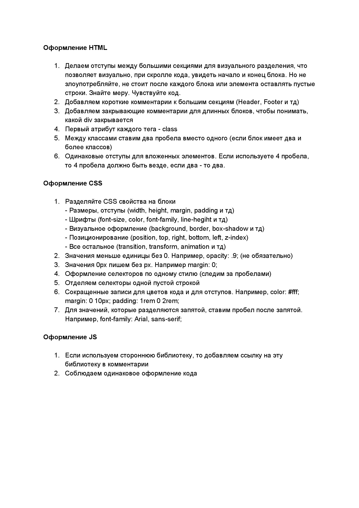

# misc

## BEM

**PageSpeed Insights:** [pagespeed.web.dev](https://pagespeed.web.dev/)

[](BEM/data/checklist.pdf)

```css
/* Пример оформления CSS */
.someclass {
  /* Размеры, отступы */
  content: "";
  display: block;
  width: 200px;
  height: 200px;
  margin: 0;
  padding: 0;

  /* Шрифты */
  font-family: serif;
  color: #000;
  font-size: 24px;
  font-weight: 700;
  line-height: 1.2;

  /* Визуальное оформление */
  background: linear-gradient(to bottom, #f5576c, #f093fb);
  border: 2px solid #9c4a4a;
  box-shadow: 0 5px 25px rgba(0, 0, 0, 0.15);
  border-radius: 5px;

  /* Позиционирование */
  position: absolute;
  right: 5rem;
  bottom: 8rem;
  z-index: 1;

  /* Всё остальное */
  transition:
    background 0.1s linear,
    color 0.1s linear;
  transform: translate3d(0, -100px, 0);
  animation: circleRadius 12s alternate infinite;
}
```

> [!TIP]
>
> **О чем стоит помнить**
>
> - Думайте об адаптивности блока сразу.
> - Учитывайте взаимодействие пользователя с сайтом.
> - Четко определяйте роль каждого блока.
> - Избегайте фиксированных размеров там, где это не нужно.

## systemFonts

```css
body {
  font-family:
    -apple-system, BlinkMacSystemFont, "Segoe UI", Roboto, Helvetica, Arial,
    sans-serif, "Apple Color Emoji", "Segoe UI Emoji", "Segoe UI Symbol";
}
```
